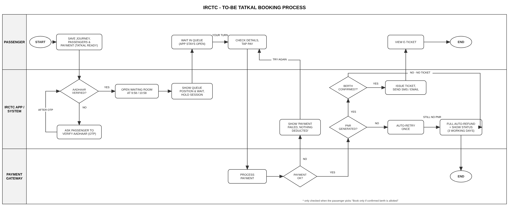
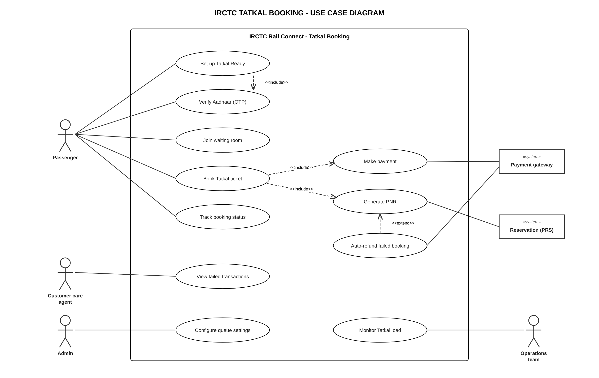

# IRCTC – Tatkal Booking (Business Analysis Project)

A business analysis project on Tatkal booking in the IRCTC Rail Connect app. Tatkal opens at 10 AM (AC) and 11 AM (non-AC) the day before travel, and good trains sell out in minutes, so those first few minutes decide everything.

I pulled 5,100 real reviews of the app from the Google Play Store (5–20 Oct 2026) and went through the 733 detailed complaints. The big ones were the app being slow or showing "high load" (30%), money being taken without a ticket (28%) and Tatkal failing when the window opens (21%).

## What's in this repo

| File | What it is |
|---|---|
| `IRCTC_Tatkal_BA_Project.pdf` | The full project in one document |
| `ToBe_Process_Flow.png` | To-Be swimlane (Passenger / App / Payment gateway) |
| `Use_Case_Diagram.png` | UML use case diagram |
| `IRCTC_Tatkal_Wireframes.pdf` | 5 screens: Tatkal Ready, waiting room, review and pay, booking status, customer care |
| `IRCTC_PlayStore_Reviews_Oct2026.xlsx` | The review data I used, tagged by issue |

## What I did

1. **Understanding the need** – review analysis, real quotes, current Tatkal rules, problem statement
2. **BRD** – objectives, scope, stakeholders, As-Is / To-Be, 11 business requirements (MoSCoW), assumptions, constraints, risks, KPIs
3. **FRD** – user roles, 15 functional requirements, business rules, data, notifications, NFRs, traceability matrix
4. **Process flow** – To-Be swimlane in draw.io
5. **Wireframes** – 5 screens in Axure with widget notes
6. **Use case diagram** – draw.io
7. **User stories** – 10 stories with acceptance criteria for a Jira backlog
8. **UAT test cases** – 12 test cases linked back to the requirements

## The main ideas

- **Tatkal Ready** – save train, passengers and payment the day before
- **Waiting room** – a queue number instead of "high load, please retry", no logouts
- **Clear booking status** – if payment goes through but no PNR, retry once then auto-refund with a date

## Process flow

## Use case diagram

## Tools

draw.io · Axure RP · Jira · MS Word / Excel

---
*Self-initiated portfolio project. The solution is my own and isn't IRCTC's real plan; the app reviews are real.*
